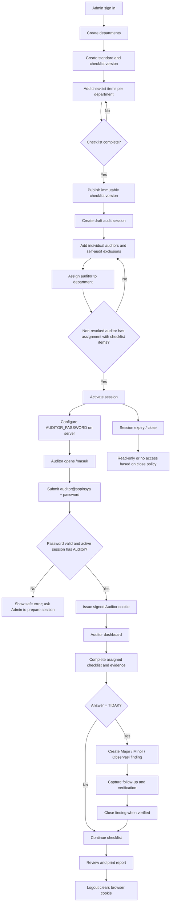
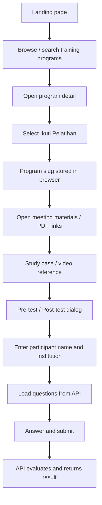

# Sopinsya — Flow & UX Review Artifact

**Repository:** [buleyyy/capstone-sopinsya](https://github.com/buleyyy/capstone-sopinsya)  
**Review date:** 27 October 2026  
**Scope:** Public participant portal, Admin/Auditor portal, session lifecycle, access flow, layout consistency, and UAT readiness.

## 1. Executive summary

Sopinsya is a dual-portal application, not a single web screen: `apps/web` serves training participants while `apps/api` hosts the API and the server-rendered Admin/Auditor interface. The most important flow defect found was an authentication mismatch: Admin could issue an individual invitation but the invitation URL redirected to the shared-login gate. That prevented the intended per-auditor identity from being established consistently.

The implementation branch introduces an explicit invitation activation page, uses the one-time claimed session token for the Auditor cookie, authenticates that token on every Auditor request, invalidates it during logout, and prevents the Admin UI from activating a session before a non-revoked auditor has a valid assignment with checklist items. The Admin dashboard setup list is also split into discrete, actionable steps.

These changes are code/documentation changes. They are not evidence of a successful typecheck, test run, browser test, security review, or client UAT. Those checks remain required.

## 2. Product and actor map

| Actor | Entry point | Main tasks | Access boundary |
|---|---|---|---|
| Participant | Public Next.js site, port 3000 | Browse training programs, open materials/videos/case studies, complete pre/post-test | No staff login; joined-program preference is browser-local |
| Admin | Express `/masuk`, port 4000 | Manage departments, checklist versions, audit sessions, auditors, assignments, SOP library | Admin password; CSRF validation on state-changing forms |
| Auditor | Shared role login at `/masuk` using `auditor@sopinsya` + `AUDITOR_PASSWORD` | Complete checklist, create findings, update follow-up, view/print report | Password role selects the first non-revoked Auditor record in the newest ACTIVE session; signed cookie and database access checks protect routes, but this is not an individual identity login |
| Trainer | Not a separate current role | Some training content may be managed in current Admin/SOP tooling | Separate role and permissions must be agreed before being represented as implemented |

## 3. End-to-end audit workflow



### Access and lifecycle rules

- Auditor login uses the fixed role email `auditor@sopinsya` and the server-side `AUDITOR_PASSWORD`; legacy invitation URLs redirect back to the password login.
- The authenticated browser receives a signed HttpOnly cookie with a limited lifetime. The Auditor identity and session/assignment permissions are checked against the database on each request.
- Logout clears the browser cookie. Since the current cookie is stateless, logout does not revoke a copied cookie on the server; keep its lifetime short and consider server-tracked sessions before formal use.
- An Auditor may only access their own session and assignments. A revoked Auditor or inaccessible session must not be able to write.
- Checklist versions are immutable after publication; a revision should be created as a new version.
- A session cannot be activated from the Admin route until at least one non-revoked auditor has an assignment with one or more checklist items.
- A session past its write deadline is read-only. Closing behavior depends on the configured read-access window.

## 4. Participant learning flow



**Boundary to make explicit:** program-following preference is browser-local, not a server-backed enrollment. Do not present it as an approved participant-registration workflow. Test attempts use the API; the enrollment/identity policy still needs product confirmation if persistence, reporting, or cross-device progress is required.

## 5. Navigation and page hierarchy

### Admin

1. **Dashboard:** high-level metrics, latest sessions and a sequential setup checklist.
2. **Sesi Audit:** session list plus draft creation.
3. **Detail Sesi:** session status, deadline/closure actions, auditor list, invitation controls, assignment list, and register of findings.
4. **Master Checklist:** standards, versions, checklist items and publication.
5. **Departemen:** the master list of units used for assignments and self-audit exclusion.
6. **Pustaka SOP:** programs/rooms and published PDF links.

### Auditor

1. **Dashboard Audit:** progress, conformity percentage, finding totals and unit shortcuts.
2. **Checklist per unit:** progress, YA/TIDAK, notes, evidence URL, partial save feedback and related finding action.
3. **Register Temuan:** classification, problem/location/evidence/reference, follow-up, status and links to report.
4. **Laporan:** print-oriented unit report.
5. **Pustaka SOP:** published program and document references.

### Participant

1. **Landing:** platform value and links to training.
2. **Program listing:** search, category filters, joined list and empty states.
3. **Program detail:** meeting accordion and links to PDFs, case study, video and tests.
4. **Room / Kamar:** public material group content fetched from API.
5. **Test dialog:** participant identity, question workflow, unanswered confirmation, submission result and error/retry states.

## 6. Layout and interaction rules

Use these as the consistency contract for the UI pass:

- **Hierarchy:** one clear page-level `h1`; supporting context directly beneath it; `h2` for functional sections and `h3` inside cards/panels. Avoid a dense stack of unlabelled forms.
- **Content width:** constrain landing/detail content to a readable centered container; allow audit tables to scroll horizontally instead of shrinking columns until text is unreadable.
- **Spacing:** use a consistent 8px rhythm for related controls and 16–24px between sections. Group related fields and actions in a panel; keep destructive actions visually separated from primary actions.
- **Navigation:** keep the active Admin/Auditor location clearly identifiable; dashboards should link to the next actionable setup step; preserve return links from checklist, findings and reports.
- **Forms:** labels must be visible and associated with controls; show required/optional clearly; keep server validation messages near the relevant flow; never rely on color alone.
- **Feedback:** every submit/save/close/reissue path needs success, validation, expired/unauthorized, unavailable and empty states. Preserve user-entered values where safe when validation fails.
- **Status semantics:** use text as well as badge color for Draft, Active, Closed, Published, Open/Closed finding, and Major/Minor/Observasi.
- **Responsive behavior:** at tablet widths, collapse the two-column shell and let the top navigation wrap/scroll. On mobile, forms and action buttons should be easy to tap, grid cards should become one column, and tables should remain horizontally scrollable.
- **Accessibility:** keep keyboard-visible focus, meaningful button/link text, semantic fieldsets for radio groups, accessible dialog behavior, sufficient contrast, and a skip-to-content link.
- **Low-connectivity mode:** the staff portal avoids JavaScript/CDN and should continue to work with native forms; external PDF/video resources still require network access.

## 7. Implementation changes in this branch

| Area | Change |
|---|---|
| Auditor login | `/masuk` accepts `admin@sopinsya` + `ADMIN_PASSWORD` or `auditor@sopinsya` + `AUDITOR_PASSWORD`. |
| Auditor session | Password is verified before issuing a signed Auditor cookie; each request checks the Auditor/session against the database. |
| Legacy invite URL | Old `/undangan/:token` links redirect to the password login; the activation page was removed. |
| Admin sign-in | The shared login page explains both role emails and requires the correct password for the selected role. |
| Session readiness | Activation from the Admin route is rejected unless the write deadline is in the future and a non-revoked auditor has an assignment with checklist items. |
| Draft deadline recovery | Admin can set a new future deadline on a DRAFT session if the original deadline passed. |
| Draft recovery | Admin can revise an expired draft deadline and reissue individual invitations while a session is DRAFT; claiming remains blocked until session access is allowed. |
| Dashboard setup | Setup checklist split into department, published checklist, session, auditor, assignment and activation stages with deep links. |
| Documentation | README and UAT runbook describe role-specific email/password login and its shared-identity limitation. |
| Automated test | Integration tests cover correct and incorrect role passwords, dashboard access, and legacy invitation URL redirection. |

## 8. Acceptance matrix

| ID | Area | Acceptance criterion |
|---|---|---|
| AUTH-01 | Admin login | No Admin cookie redirects staff routes to `/masuk`; a wrong password does not create a session. |
| AUTH-02 | Auditor role login | `auditor@sopinsya` with `AUDITOR_PASSWORD` opens the Auditor dashboard without an invite link. |
| AUTH-03 | Role separation | The Admin password does not authenticate `auditor@sopinsya`, and the Auditor password does not authenticate `admin@sopinsya`. |
| AUTH-04 | Session cookie | Unsigned or expired Auditor cookies cannot open protected routes; Auditor session and assignment scope are checked against the database. |
| AUTH-05 | Logout | Logout clears the cookie in the browser; note that a copied signed cookie remains valid until expiry or account revocation. |
| ADMIN-01 | Checklist | Empty versions cannot be published; published versions cannot be edited. |
| ADMIN-02 | Session activation | Activation is blocked until the write deadline is in the future and an eligible auditor has a checklist-bearing assignment. |
| ADMIN-04 | Draft expiry | A DRAFT session with a past deadline can be rescheduled to a future deadline before activation. |
| ADMIN-05 | Auditor access management | Admin can prepare/revoke Auditor records and assignments; only non-revoked Auditor records are eligible for role login. |
| ADMIN-03 | Self-audit | A restricted auditor cannot be assigned to an excluded department. |
| AUD-01 | Scope | Auditor cannot read/write another auditor's assignment. |
| AUD-02 | Checklist | YA/TIDAK, notes and HTTPS evidence persist; expired sessions become read-only. |
| AUD-03 | Finding | Finding class and required facts show consistently in register and report. |
| UX-01 | Responsive | Desktop/tablet/mobile views retain clear hierarchy, readable controls and horizontal table handling. |
| UX-02 | Feedback | Empty, loading, failure, validation, success, expired and access-denied states are understandable. |
| UAT-01 | Login recovery | Auditor can log in again after clearing the browser cookie using the role password. |

## 9. Open decisions and residual risks

Refer to `docs/PENDING-DECISIONS.md` for the authoritative list. Key items that require the client/team to decide:

- Checklist response set (whether N/A / partially compliant is needed).
- Definition of dashboard percentage and report export format.
- Retention policy and access to closed sessions.
- Whether one auditor may have multiple units, and the approved exclusion/self-audit policy.
- Ownership and final contents of training rooms/13 Programs and SOPs.
- Whether evidence should remain an external HTTPS URL or move to managed file storage.
- Exact follow-up ownership, due dates and verification role.
- The participant enrollment model and whether Trainer needs a separate role.

The shared role credentials automatically resolve to the first non-revoked Auditor in the newest ACTIVE session. This cannot securely distinguish several people with different assignments. Before formal use with multiple auditors, provide individual credentials and server-managed sessions rather than relying on one shared role password.

## 10. Validation to run before merge

From repository root:

```powershell
npm run typecheck
npm run lint
npm test
npm run build
```

Then follow `docs/RUNBOOK-UAT.md` on a clean development database and check the public/staff portals at desktop and mobile widths. Capture actual pass/fail results; do not mark tests as passed until their commands and browser/UAT scenarios have completed successfully.
